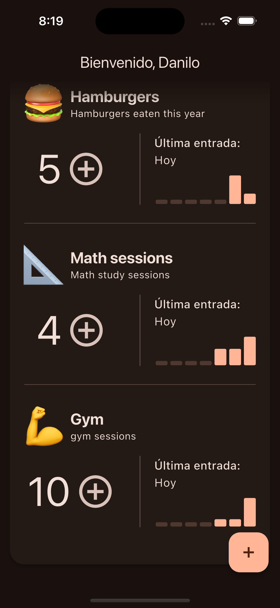
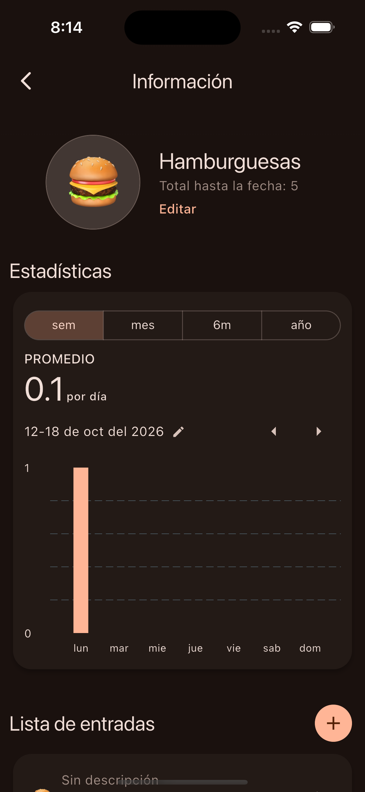
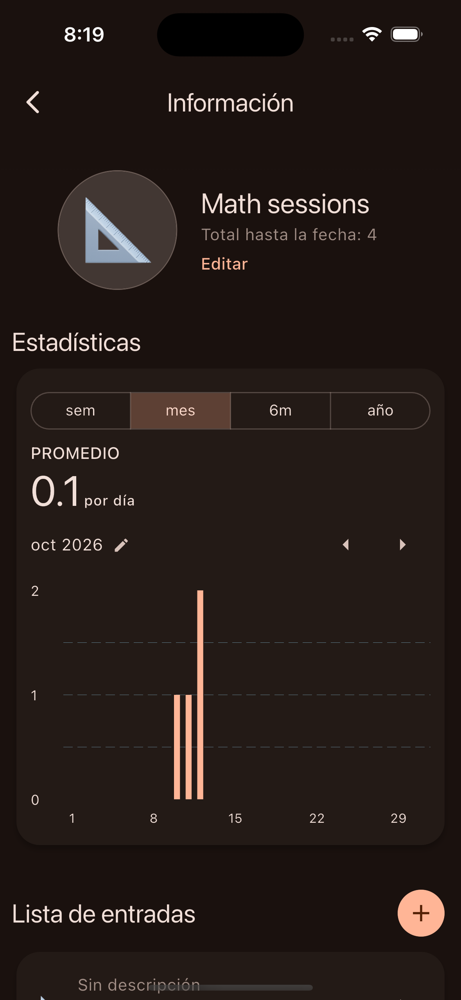
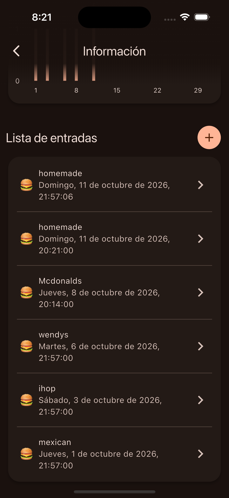

<div align="center">

# 🔢 addit

**Count what matters. One entry at a time.**

A personal counter app with built-in stats, made with Flutter.


</div>

> 🧪 **Practice project.** addit started as a personal project to practice Flutter, state management, and clean architecture. It's not a production app, but it's built with the care of one that could be.

---

## 📸 Screenshots

<div align="center">
<table>
  <tr>
    <td align="center"><br /><sub>Home screen</sub></td>
    <td align="center"><br /><sub>Weekly stats</sub></td>
  </tr>
  <tr>
    <td align="center"><br /><sub>Monthly view</sub></td>
    <td align="center"><br /><sub>Entry list</sub></td>
  </tr>
</table>
</div>

## ✨ Features

- **Custom counters**: each with its own name, description, and emoji.
- **Quick logging**: add an entry with a single tap from the home screen.
- **Dated entries with descriptions**: every increment is saved with its date and time.
- **Stats by period**: bar charts by week, month, 6 months, and year, with a daily average.
- **Latest entry at a glance**: the home screen shows when each counter was last updated.
- **Dark theme** with a warm color palette.

## 🛠️ Tech stack

| Tool | What it's used for |
|---|---|
| [Flutter](https://flutter.dev) / Dart | UI and app logic |
| [Riverpod](https://riverpod.dev) | State management and dependency injection |
| [Drift](https://drift.simonbinder.eu) | Local persistence on top of SQLite |

## 🧱 Architecture

Data access sits behind an abstraction (`CountersDatasource`), so the UI and state layers don't know whether data comes from an in-memory list or a database. This made it possible to build the app first against a mock datasource and then switch to Drift without touching the rest of the code.

Sorting logic (for example, a counter's latest entry) lives in the model rather than in the data layer.

```
lib/
├── core/
├── features/
│   └── counters/
│       ├── data/          # datasources and implementations
│       ├── domain/        # models (Counter, CounterEntry)
│       └── presentation/  # screens, widgets, providers
└── main.dart
```

> ✏️ Adjust this tree to match your actual project structure.

## 🚀 Getting started

You'll need [Flutter](https://docs.flutter.dev/get-started/install) installed.

```bash
git clone https://github.com/YOUR_USERNAME/addit.git
cd addit
flutter pub get
flutter run
```

If you use code generation (Drift, Riverpod generator):

```bash
dart run build_runner build --delete-conflicting-outputs
```

## 🗺️ Roadmap

- [x] Counters and entries
- [x] Stats by week, month, 6 months, and year
- [ ] Full persistence with Drift
- [ ] Edit and delete entries
- [ ] Data export

## 👤 Author

Made by **Danilo**, a student at ESPOL.

[GitHub](https://github.com/YOUR_USERNAME)
